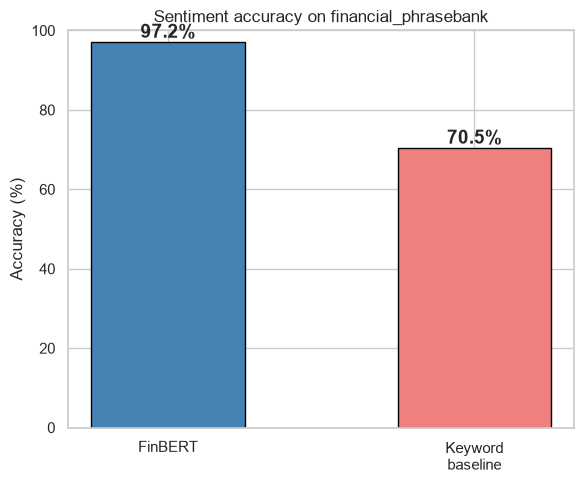

# FinBERT sentiment comparison

Compare pretrained FinBERT sentiment labels with a small keyword baseline on financial sentences.

**Saved notebook accuracy: 97.2% for FinBERT versus 70.5% for the keyword baseline on 2,264 sentences.** This is a dataset comparison, not an independent holdout or a returns-prediction result.



## Quick start

From the repository root:

```bash
python3 -m venv .venv
.venv/bin/pip install -r requirements-dev.txt
.venv/bin/python -m pytest -q
```

Model tests download public `ProsusAI/finbert` weights when uncached. The Python environment is pinned; the model revision is not pinned in the original loader. For the larger dataset study, `python scripts/download_data.py` uses the archive linked by the model authors, then `python -m src.evaluate` runs the comparison. The provider returned HTTP 403 during cleanup. Download its archive in a browser, then use `python scripts/download_data.py --archive /path/to/archive.zip`.

## Method

- Tokenize financial sentences and run pretrained FinBERT in evaluation mode.
- Convert logits into positive, negative and neutral probabilities.
- Compare with set-based positive/negative keyword counts.
- Compute accuracy, per-class precision/recall and confusion matrices.
- Use the Financial PhraseBank all-agreement subset in the saved notebook.

## Results

| Saved notebook comparison | Accuracy |
|---|---:|
| FinBERT | 97.2% |
| Keyword baseline | 70.5% |

The image is extracted from [the saved notebook](notebooks/01_finbert_sentiment.ipynb) without re-executing cells. The full dataset evaluation was not rerun during cleanup.

## What didn't work

Keyword matching misses context and defaults to neutral without recognized words. The [model card](https://huggingface.co/ProsusAI/finbert) identifies Financial PhraseBank as fine-tuning data: this evaluation has no independently established holdout. No sentiment-to-returns study is implemented despite the repository name. TODO: independent evaluation and reproducible model revision.

## Tests, structure and licence

[](https://github.com/VChahar1/finbert-sentiment-returns/actions/workflows/tests.yml)

Six tests pass using the actual model and keyword functions. `src/` contains scoring, evaluation and plotting; `notebooks/` retains saved results; `scripts/` handles data and chart extraction. Code: [MIT](LICENSE). Dataset and model weights retain their separate provider terms and are not bundled.
